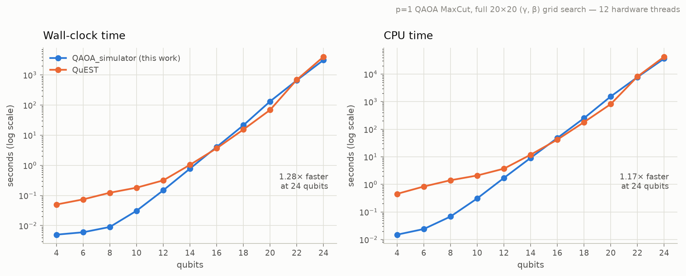
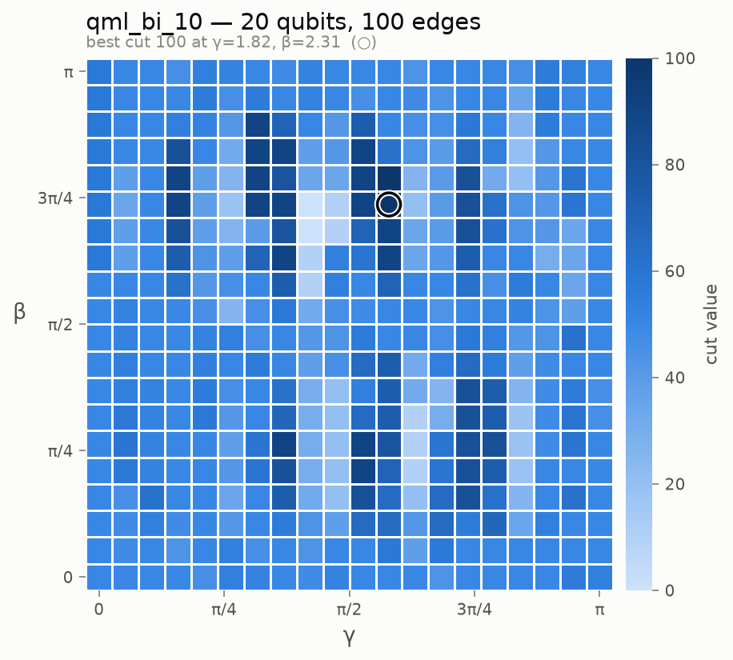
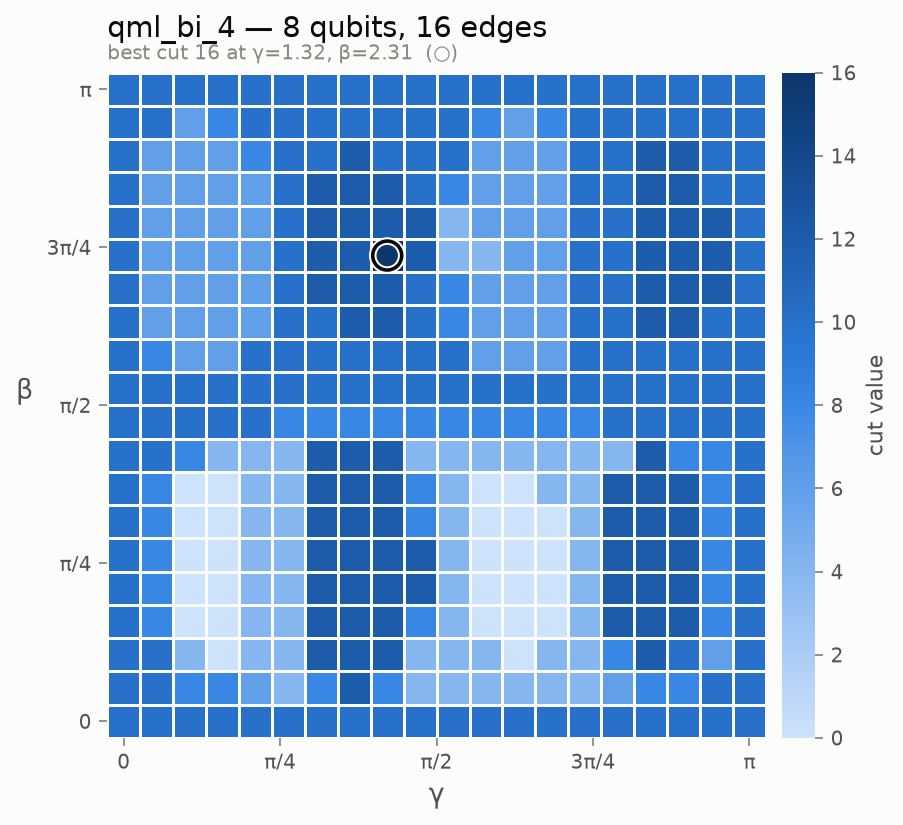
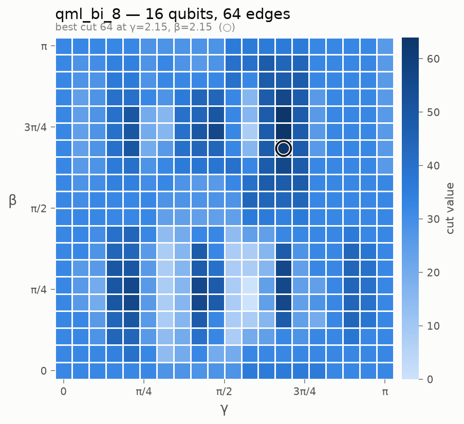
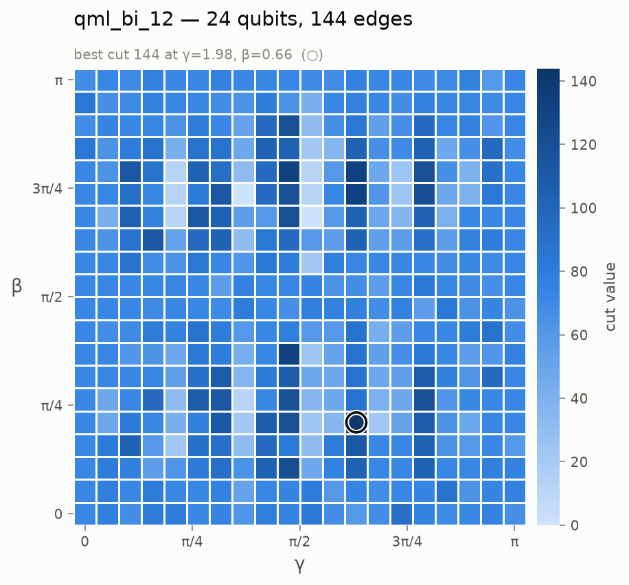
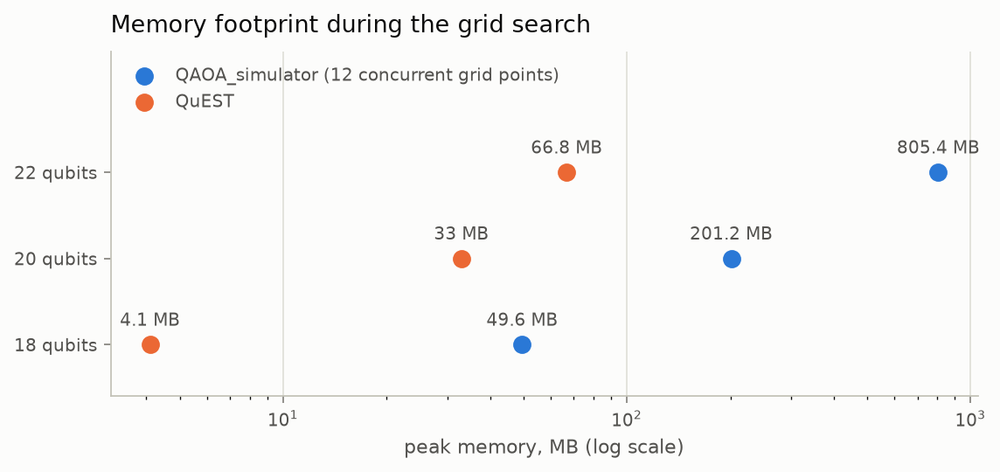

# QAOA_simulator

**A from-scratch, OpenMP-parallel state-vector simulator for the Quantum Approximate Optimization Algorithm (QAOA), applied to MaxCut — benchmarked head-to-head against [QuEST](https://github.com/QuEST-Kit/QuEST).**


No quantum SDK, no external libraries — every gate kernel is hand-written C++, and the whole gate engine fits in ~160 lines. On the same workload (a full 20×20 parameter grid search of the p=1 QAOA circuit), it **overtakes the established QuEST simulator at the largest tested sizes: 1.28× faster wall-clock and 1.17× less total CPU time at 24 qubits**, and it recovers the known optimal cut on **every** benchmark instance from 8 to 24 qubits.



## Highlights

- **Hand-rolled state-vector engine.** `createState` allocates the full `2^n` complex amplitude array; `H`, `Rx`, `Rz`, `CNOT` and `CP` are implemented directly on it. The core trick is a branch-free *bit-insertion* index map (`insert_bit_0/1`) that enumerates each amplitude pair exactly once, so every gate is a single embarrassingly-parallel loop with unit-stride-friendly access — no gate matrices, no copies of the state.
- **Two-level OpenMP parallelism.** Gate kernels parallelize over amplitudes, and the driver parallelizes over the entire `(γ, β)` grid with `collapse(2) schedule(dynamic)` — up to 400 independent circuit instances dispatched across cores. OpenMP's default handling of nested regions means the two levels compose cleanly: a single circuit still uses all cores through the gate kernels, while a grid search saturates them at the circuit level with no oversubscription.
- **Competitive with an established simulator.** Head-to-head against QuEST running the identical circuit and grid search: faster at every size up to 14 qubits, and faster again at 22–24 qubits where the runs take the better part of an hour (see [Benchmarks](#benchmarks-vs-quest)).
- **Optimal cuts on every benchmark.** On the HamLib complete-bipartite instances `K_{N,N}` (where the optimum is known: cut *all* `N²` edges), the p=1 grid search finds the exact optimum on all nine instances from 8 to 24 qubits.
- **Cheap measurement via marginal sampling.** Per-qubit marginals are computed in one pass over the state, after which each additional shot costs only O(n) — see [Approximations](#approximations-under-the-hood).
- **Complete, reproducible pipeline.** Dataset download (PennyLane HamLib) → C++ simulation → CSV export → publication-ready heatmaps and benchmark figures, each step a single command.

## The algorithm in one paragraph

QAOA (Farhi, Goldstone & Gutmann, 2014) is a variational quantum algorithm for combinatorial optimization. For MaxCut on a graph `G = (V, E)`, the p=1 circuit prepares `|+⟩^n`, applies the **cost layer** `e^{-iγ H_C}` (for each edge `(i,j)`: `CNOT(i,j) · Rz_j(2γ) · CNOT(i,j)`), then the **mixing layer** `e^{-iβ H_B}` (`Rx(2β)` on every qubit), and measures in the computational basis. The measured bitstring is a graph bipartition; its cut value is the number of edges crossing it. The classical outer loop tunes `(γ, β)` to maximize the cut — here, by an exhaustive grid search over `[0, π]²` that doubles as a full map of the optimization landscape:

<p align="center">
  
</p>

Landscapes for all nine benchmark instances (8–24 qubits) are in [docs/figures/heatmaps/](docs/figures/heatmaps/):

| 8 qubits (`qml_bi_4`) | 16 qubits (`qml_bi_8`) | 24 qubits (`qml_bi_12`) |
|---|---|---|
|  |  |  |

## Approximations under the hood

Three deliberate approximations keep the search fast; each is a conscious trade-off, not a shortcut taken silently.

1. **QAOA is itself an approximation algorithm.** It does not guarantee the exact MaxCut — it guarantees a good cut, improving with circuit depth `p` (at p=1, the classic worst-case bound for 3-regular graphs is a 0.6924 approximation ratio). This project runs the shallowest ansatz, p=1, where the landscape over `(γ, β)` is smooth and periodic — which is exactly why a modest grid brackets the optimum. On the bipartite benchmarks the sampled optimum turned out to be the true one on every instance.

2. **Grid search instead of a gradient optimizer.** The standard variational loop (gradient descent / COBYLA on `⟨H_C⟩`) is sequential: each parameter update waits for the previous evaluation. A fixed 20×20 grid gives up adaptivity in exchange for **400 completely independent evaluations** — a perfect fit for `#pragma omp parallel for collapse(2)`, and it produces the full landscape heatmap as a free by-product.

3. **Independent-marginal measurement sampling.** Exact multi-shot sampling either re-collapses the state per shot or builds a cumulative distribution over all `2^n` amplitudes. Instead, the simulator computes each qubit's marginal `P(qᵢ = 0)` in one parallel pass over the state, then draws every shot as `n` independent Bernoulli samples — O(n) per shot instead of O(2^n). This is a mean-field-style approximation: inter-qubit correlations of the joint distribution are dropped at sampling time (the state evolution itself is exact). For cut statistics on these instances it is empirically excellent — it is the sampler that recovered the optimal cut on all nine benchmarks. Each grid point reports the best cut over its shots.

## Benchmarks vs QuEST

**Setup.** Identical workload for both simulators: the p=1 QAOA circuit with a full 20×20 `(γ, β)` grid search per graph, on complete-bipartite HamLib graphs from 4 to 24 qubits, timed with `time(1)` on the same 12-thread CPU. The QuEST reference implementation, raw timing records, and QuEST outputs are in [benchmarks/](benchmarks/).

| qubits | edges | **this work** (wall) | QuEST (wall) | **this work** (CPU) | QuEST (CPU) |
|:-:|:-:|:-:|:-:|:-:|:-:|
| 20 | 100 | 2m 12s | 1m 09s | 25m 43s | 13m 36s |
| 22 | 121 | **11m 01s** | 11m 30s | **129m 09s** | 135m 21s |
| 24 | 144 | **51m 52s** | 66m 39s | **607m 30s** | 709m 24s |

Below 16 qubits this simulator wins by up to an order of magnitude (near-zero startup cost); QuEST takes the middle sizes; from 22 qubits upward this simulator pulls ahead again — at 24 qubits it saves **15 minutes of wall-clock per graph**. Full curves are in the figure at the top.

**Memory trade-off.** The grid-level parallelism keeps one state vector alive per thread (~12 concurrent `(γ, β)` evaluations), so peak memory is roughly 12 state vectors versus QuEST's single one — memory deliberately traded for wall-clock speed. System-monitor screenshots backing these numbers are in [benchmarks/memory_screenshots/](benchmarks/memory_screenshots/).



## Quick start

```bash
# Build (requires g++ with OpenMP)
make

# Run: ./qaoa_main <graph_name> <shots> <steps>
#   <graph_name> — file in ./graph/     <shots> — measurement shots per grid point
#   <steps>      — grid resolution: steps × steps points over (γ, β) ∈ [0, π]²
./qaoa_main qml_bi_10 1 20
```

The full grid log is written to `results/qml_bi_10/1_20_0` (named `<shots>_<steps>_<run>`), and a summary is echoed to the terminal:

```
=========================================
 QAOA (p=1) with 20 qubits.
 Input graph: qml_bi_10 (edges=100)
 Grid search steps = 20, shots = 1
-----------------------------------------
 Best found cut   = 100
 Best gamma       = 1.81882
 Best beta        = 2.31486
=========================================
```

### Plots and CSV

```bash
pip install matplotlib numpy

python3 scripts/plot_heatmap.py results/qml_bi_10/1_20_0   # landscape heatmap
python3 scripts/transform_to_csv.py results/qml_bi_10/1_20_0  # grid log → CSV
python3 scripts/plot_time.py                               # runtime benchmark figure
python3 scripts/plot_memory.py                             # memory benchmark figure
```

### Graphs

Benchmark graphs `K_{N,N}` for 2–50 qubits ship in [graph/](graph/). The input format is plain text: number of nodes, number of edges, then one `u v` pair per line. Two generators are included:

```bash
python3 scripts/generate_graph.py       # random n-node, m-edge graph (G(n, m) model)
pip install pennylane
python3 scripts/download_maxcut.py      # fetch HamLib MaxCut graphs via PennyLane
```

## Repository layout

```
QAOA_simulator/
├── src/                    # C++17 state-vector engine + QAOA driver
│   ├── state.{hpp,cpp}       # 2^n amplitude array, |0…0⟩ initialization
│   ├── circuit.{hpp,cpp}     # H, Rx, Rz, CNOT, CP gate kernels (OpenMP)
│   └── main.cpp              # p=1 QAOA, (γ, β) grid search, marginal sampling
├── scripts/                # Python tooling (download, CSV, figures)
├── graph/                  # bundled benchmark graphs (K_{N,N}, 2–50 qubits)
├── results/                # raw grid-search logs + CSV (8–24 qubits)
├── benchmarks/             # QuEST comparison: timing records, QuEST outputs,
│                           #   memory screenshots
└── docs/figures/           # generated figures used in this README
```

## References

- E. Farhi, J. Goldstone, S. Gutmann, *A Quantum Approximate Optimization Algorithm*, [arXiv:1411.4028](https://arxiv.org/abs/1411.4028) (2014).
- T. Jones, A. Brown, I. Bush, S. C. Benjamin, *QuEST and High Performance Simulation of Quantum Computers*, [Sci. Rep. 9, 10736](https://www.nature.com/articles/s41598-019-47174-9) (2019).
- N. P. D. Sawaya et al., *HamLib: A library of Hamiltonians for benchmarking quantum algorithms and hardware*, [arXiv:2306.13126](https://arxiv.org/abs/2306.13126) (2023) — MaxCut instances loaded via [PennyLane Datasets](https://pennylane.ai/datasets).

---

*Originally developed as the final project for a Quantum Design Automation course (Dec 2024).*
